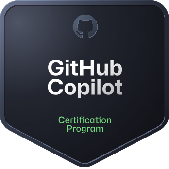

***** My GitHub profile README and developer portfolio *****

Hi, I'm Jaswanth
 Computer Science Engineering Student
 
🏆 Certifications

- **GitHub Copilot Certification**
  - Issued by: GitHub
  - Earned: November 7, 2026
  - Valid until: November 8, 2028
  - Skills: GitHub Copilot, AI-assisted coding, Developer Productivity
  - Credential ID : F2867B1FA264A95C
  - Skills : AI-assisted coding, GitHub Copilot, Prompt Engineering
  - link : https://learn.microsoft.com/api/credentials/share/en-us/NADIKOTAJASWANTH-2290/F2867B1FA264A95C?sharingId=55A48B9FFA1DAE5C

### 🏅 Certification Badge

[Verify My Certification](https://learn.microsoft.com/api/credentials/share/en-us/NADIKOTAJASWANTH-2290/F2867B1FA264A95C?sharingId=55A48B9FFA1DAE5C)
